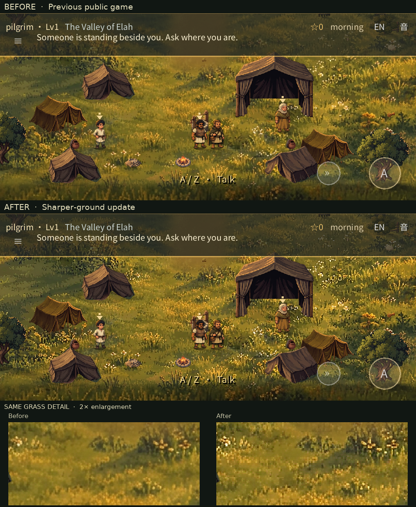
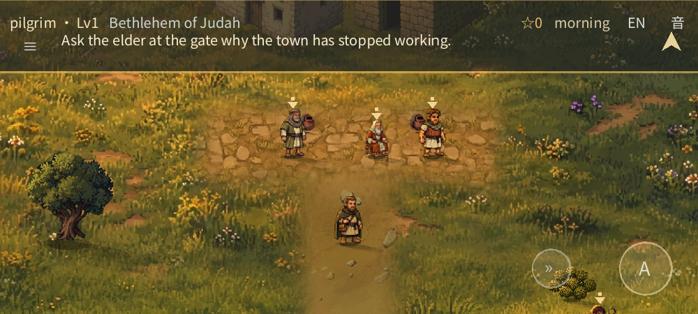

# Ground clarity follow-up

**Status: previously published with the user's approval.** Game-source revision `f2afae9` passed [CI](https://github.com/fongway94/WalkInCovenant/actions/runs/43342207189), which supplied the exact Web artifact used by the [one-time publication](https://github.com/fongway94/WalkInCovenant/actions/runs/43344202582). The [public game](https://fongway94.github.io/WalkInCovenant/) now includes the later [painterly-ground pass](PAINTERLY_GROUND_REVIEW.md). This earlier follow-up changed the overworld ground in Elah and Bethlehem; the separately painted shepherd field, objects, paths, collision and story positions were unchanged.

## Before and after in the game

These are real 1000×450 Godot framebuffers from the same staged camera and lighting, not source-image mockups. “Before” is the earlier `d8526c3` ground; “after” is the `f2afae9` clarity pass, before the later painterly-ground update. The enlarged grass crops use nearest-neighbour scaling. The actors are frozen for comparison; a flame can differ between captures.

| Bethlehem before | Bethlehem after |
|:---|:---|
|  |  |

[Stream crossing](ground-clarity-review/crossing-after.webp) · [Elah texture join](ground-clarity-review/elah-seam-after.webp) · [Bethlehem texture join](ground-clarity-review/bethlehem-seam-after.webp) · [Actual release-Web frame at an emulated 844×390 viewport, DPR 2](ground-clarity-review/phone-camp-dpr2.webp)

## What changed

The game was already rendering ground with nearest-neighbour filtering. The blur came from the source artwork and the resampling used to build the textures, so simply toggling the runtime filter did not help. The revised builder sharpens the existing land artwork at source scale before fitting it with nearest-neighbour sampling, including the retained paving and path edges. This improves perceived clarity, but does **not** reconstruct detail missing from the original paintings or change the textures' dimensions.

The existing water, crossings and protected shoreline core remain pixel-identical to the earlier reference at the same density. A small strip of the old grass around the brook consequently remains softer; it was retained to avoid repainting the irregular bank. The split textures still meet at the same world positions and remain within the 2048-pixel texture limit.

## Checks and limits

- All four ground pieces were regenerated and verified against the committed outputs. The test independently checks the water and padded shoreline pixels against the original reference, and compares fixed ground crops to the previous published version. Mean adjacent-luminance differences rose from **4.28 to 7.07** in the Elah sample and **5.37 to 8.88** in the Bethlehem sample. This is a blur-regression indicator, not proof of visual quality or absence of motion shimmer.
- Native gameplay: painted world **129/129**, context **35/35**, shepherd stage **54/54**, resume **24/24**, slots **38/38**, audio **21/21**, deep **144**, plus smoke and content validation passed. The rendered fixture captured both texture joins and completed **12** walks/runs, **3** eased stops and **2** NPC patrols with no fixture failures.
- Strict release-Web Chromium validation passed **30/30** with no console, page or request errors. The browser layout and emulated-touch suite passed **36** checks, including the 844×390 landscape layout. A fresh real-input browser journey passed from the opening conversations through Bethlehem, the field, Saul, the brook, the duel and ending. Touch was emulated, not tested on a physical phone.
- A separate **local** service-worker upgrade simulation moved from the earlier local refinement export to this one. It loaded the new pack and preserved a genuinely earned conversation/word, chapter act and changed sound setting. It was not a live-site upgrade.
- The publication confirmed that the public PCK matches the passing CI artifact (SHA-256 `c08b0dbe8fd54fd6df28f484a42c204bd806106738ab26559e85ffbaf8009489`) and the public service worker carries the new revision. Strict public Chromium validation passed **30/30** with no console, page or request errors.
- Web and Android-preset resource packs each passed the release boundary with **856** indexed resources, including all four dynamically loaded ground pieces; the disposable browser test pack has **963**. The separately exported 29.60 MiB local Web PCK is not the published artifact; an Android PCK is not an APK.
- No physical-phone performance, human art approval or audible-quality test has been performed. The native screenshot harness still prints its pre-existing resource warnings at immediate shutdown.
