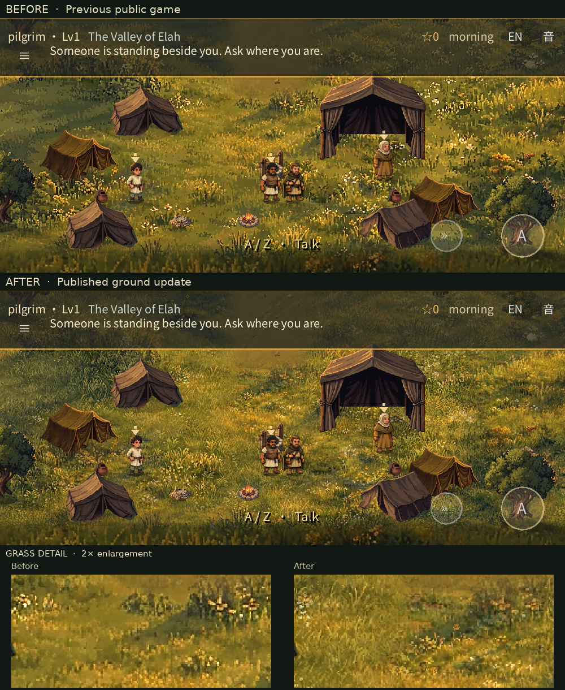
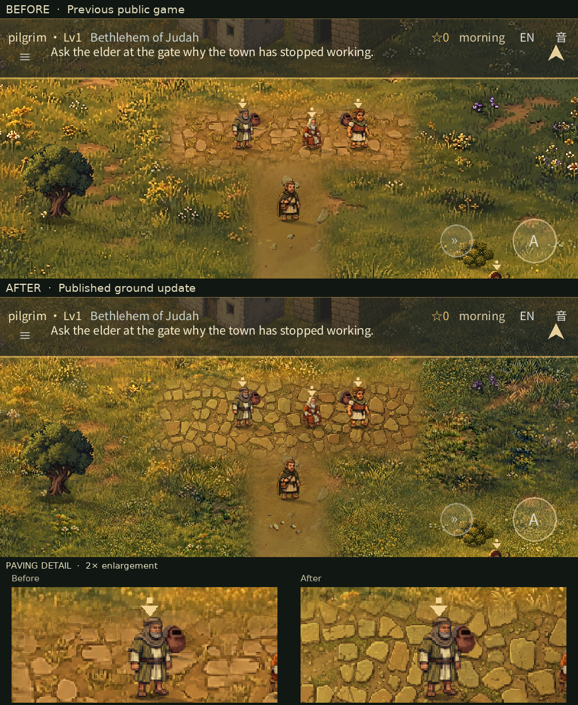

# Painterly ground materials — review

**Status: published with the user's approval.** The [public game](https://fongway94.github.io/WalkInCovenant/) uses game-source revision `0fb4c82`. Its [passing CI](https://github.com/fongway94/WalkInCovenant/actions/runs/43371609984) supplied the exact Web artifact used by the [one-time publication](https://github.com/fongway94/WalkInCovenant/actions/runs/43375913095).

## Diagnosis

The previous ground pieces already had four texture pixels per world unit, lossless imports, no mipmaps and nearest-neighbour runtime filtering. That nominal density is close to the witness rig's roughly 3.6 source pixels per world unit; individual prop scales vary. A real-render comparison had shown that inherited filtering and explicitly nearest filtering were identical; linear filtering was softer. The remaining mismatch was primarily **insufficient fine source detail and the scale/compositing of the paintings**, not a missing filter switch. Raising pixel dimensions or sharpening alone would not create blades of grass, stones or earth structure.

## In-game comparison

These are actual 1000×450 Godot framebuffers from the same staged positions, camera and lighting. “Before” uses the previous `f2afae9` public textures; “after” uses the rebuilt, now-published textures. The 2× detail crops use nearest-neighbour scaling. Actors are held at the same positions; animated effects can differ between captures.

Full frames: [camp before](painterly-ground-review/camp-before.webp) / [after](painterly-ground-review/camp-after.webp) · [Bethlehem before](painterly-ground-review/bethlehem-before.webp) / [after](painterly-ground-review/bethlehem-after.webp) · [trees before](painterly-ground-review/trees-before.webp) / [after](painterly-ground-review/trees-after.webp) · [well before](painterly-ground-review/well-before.webp) / [after](painterly-ground-review/well-after.webp) · [dry ridge before](painterly-ground-review/ridge-before.webp) / [after](painterly-ground-review/ridge-after.webp) · [stream crossing before](painterly-ground-review/crossing-before.webp) / [after](painterly-ground-review/crossing-after.webp).

Texture joins: [Elah before](painterly-ground-review/elah-seam-before.webp) / [after](painterly-ground-review/elah-seam-after.webp) · [Bethlehem before](painterly-ground-review/bethlehem-seam-before.webp) / [after](painterly-ground-review/bethlehem-seam-after.webp). [Release-Web frame at 844×390, emulated DPR 2](painterly-ground-review/phone-camp-dpr2.webp).

[Walking comparison](painterly-ground-review/ground-walk.webp): 32 pairs of actual frames at a simulated 844×390 window, using fixed 1/24-second production movement steps and a following camera. It is a staged capture, not a physical-phone recording.

## What changed and critical evaluation

- **Grass and rocky ground:** added small-scale detail from multiple generated/curated paintings rather than enlarging the old image or adding random noise. The old scene supplies broad lighting and colour, while the new material contributes individual blades, flowers and low vegetation. Previously omitted rocky cells were included after a comparison showed soft square patches around them. The results are more detailed at game scale, but the new grass is denser and brighter in places; the user should judge whether that balance is right.
- **Paths, dry earth and stones:** added irregular fine earth, sand-coloured flecks and small embedded stones to the existing paths and dry ridge. There are no separate `s` sand tiles in these two current region grids. The intended path remains visible: a first candidate put grass across the southern ford approach, so the final mask uses earth there instead.
- **Village paving:** uses two different portions of a curated stone painting. A first broad blend produced double stone outlines; the final version uses a narrow, low-difference irregular join. The stones are sharper and more visible than before, though their stronger outlines still merit visual review against the nearby characters and buildings.
- **Consistency and repetition:** material details use deterministic, varied crop positions and neighbouring patches from different sources, not one repeated tile. The existing low-frequency light and palette remain the basis for the scene. The reviewed camp, village, ridge, well, crossing and texture-join frames showed no obvious repeated tile or hard split-texture seam; this is a visual assessment of sampled positions, not a guarantee that no motif can recur anywhere.
- **Water and gameplay:** the water, reeds and visible shoreline band remain pixel-identical to the earlier reference. The ends of the wide crossing tiles include inland grass; that land was updated to soften the former blurry rectangle without changing the bank. The special case fails closed if the river/path grid or the registered shoreline painting changes. Props, map data, collisions, story positions and the separately painted shepherd field were not changed.

## Verification and limits

- All source images needed by the builder were present and passed image verification. Pillow 13.0.0 rebuilt all four production pieces exactly; the tests independently check the river/shore band, the path approach, rocky cells, paving join, material masks, palette and both split-texture boundaries.
- Mean adjacent-luminance differences in fixed grass samples rose from **7.07 to 9.50** in Elah and **8.88 to 12.47** in Bethlehem, while mean RGB shifted by less than one level per channel. This catches a blur regression; it does not prove artistic quality.
- At the texture split, the mean row-to-row difference was **1.00×** the nearby median in Elah and **1.08×** in Bethlehem. High-frequency change had correlations close to zero at the 224- and 448-pixel patch offsets sampled in both axes. These metrics supplement, but do not replace, inspection of the frames.
- Native Godot gameplay checks passed: painted world **129/129**, context **35/35**, shepherd stage **54/54**, resume **24/24**, slots **38/38**, audio **21/21**, deep **144**, plus smoke and content validation. The actual-frame fixture completed **12** walks/runs, **3** eased stops and **2** patrols with no fixture failures.
- The final local release-Web export passed strict Chromium validation **30/30** without console, page or request errors. A fresh real-input browser journey reached the ending, and the responsive layout/emulated-touch suite passed **36** checks. Touch and DPR were emulated, not tested on a physical phone.
- A local service-worker upgrade from the previous local export loaded the new pack and retained an earned conversation/word, chapter act and changed sound setting. It was not a live-site upgrade. Publication separately verified that the public PCK matches the passing CI artifact (SHA-256 `3689b9ae86a0349b7d9df014ec34aa5e8f0e551b14e888cc27c5782cb0534411`) and that the public service worker has the new revision. Strict public Chromium validation passed **30/30**, with no console, page or request errors.
- The Web and Android-preset resource packs each contain **856** indexed resources, and the disposable test pack contains **963**. The local Web PCK is **34.62 MiB**, up from **29.60 MiB** in the previous local export; texture dimensions and maximum side remain unchanged. An Android PCK is not an APK.
- No physical-phone performance, human art approval or listening test has been performed. Dense fine detail can still shimmer at other viewport sizes or under video compression; the walk capture and desktop/emulated browser checks are not a guarantee for every device. The native capture harness can report its existing resource warnings at immediate shutdown.
