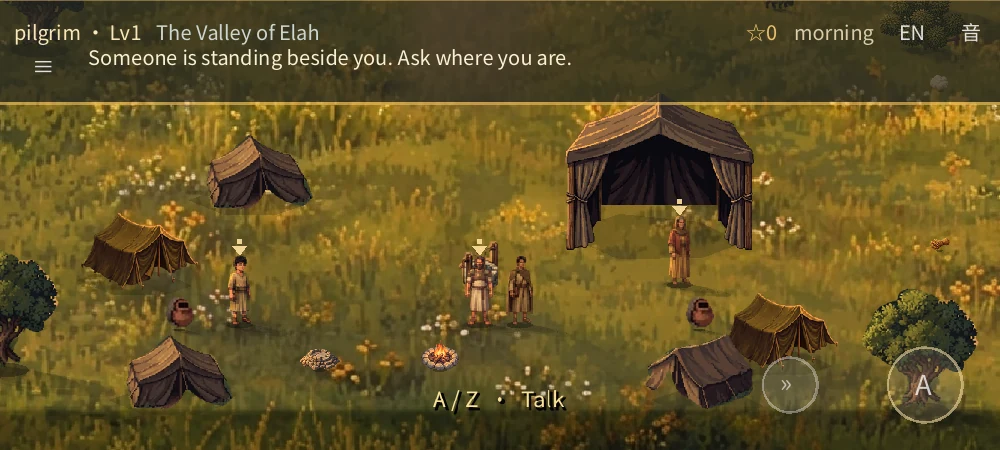
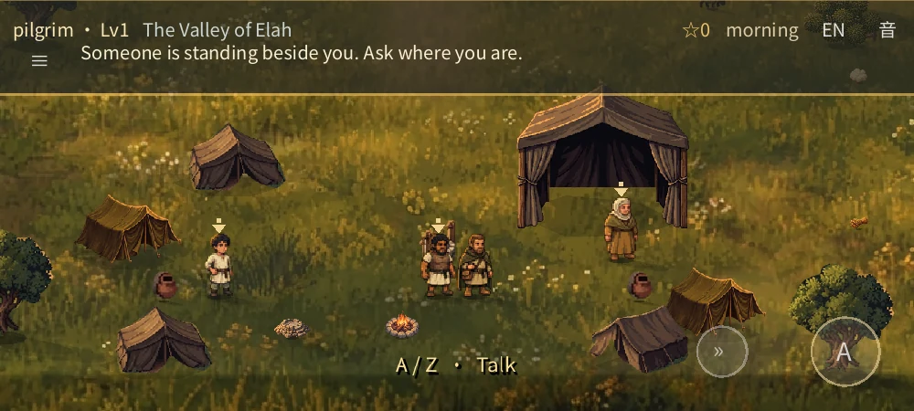
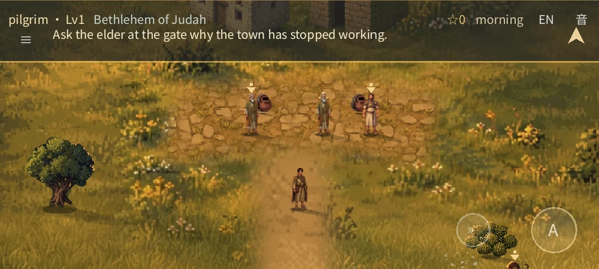
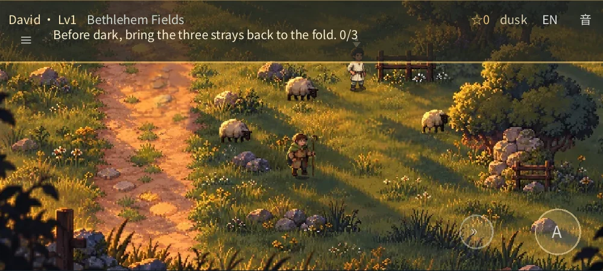
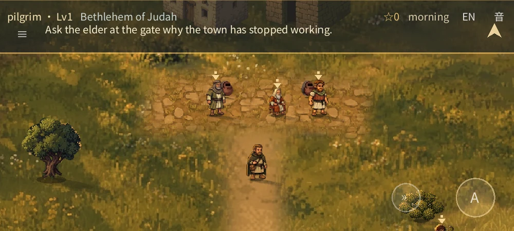
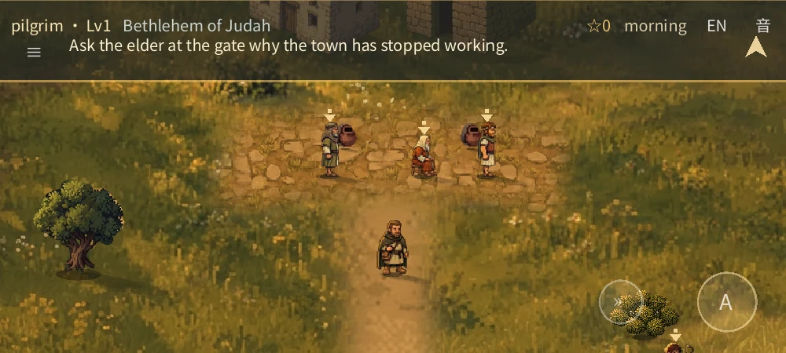
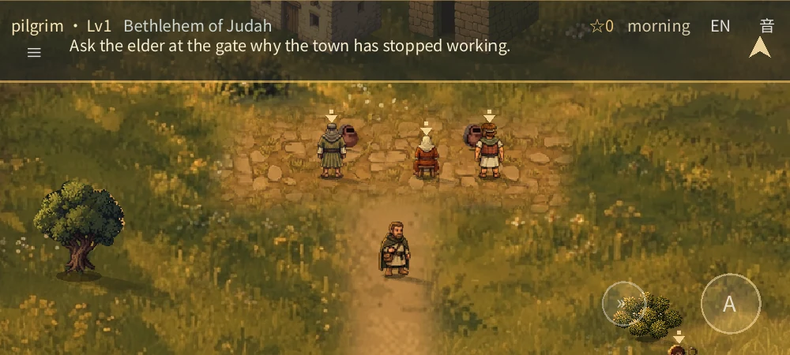

# Chapter-wide sunset-field playtest review

> This review describes the **published** revision `e66ba37`. A later, unpublished local movement, scale and ground pass is documented in [the refinement review](REFINEMENT_REVIEW.md).

This is the **David and Goliath chapter playtest**, not a finished multi-campaign game or a claim of final art approval. The user asked for the whole playable chapter—not only the shepherd field—to move toward the supplied reference, including character proportions, apparent size and detail, and authorized this fixed build for a public phone playtest.

**Play it:** https://fongway94.github.io/WalkInCovenant/ . The published artifact came from [passing CI for game revision `e66ba37`](https://github.com/fongway94/WalkInCovenant/actions/runs/43226870730). The [one-time publication](https://github.com/fongway94/WalkInCovenant/actions/runs/43229031904) checked that the public game pack matched that artifact, verified the service-worker revision and passed a strict public Chromium play-check. This review records evidence, not human approval; no physical phone has been tested.

The benchmark is the user's [1024×576 sunset-field image](../../tools/art/sources/user_reference_1024.webp). It matches the earlier 740×413 attachment; the larger file is not evidence of a different high-resolution master. Elah and Bethlehem are interpretations of that painting, not scenery copied from places it depicts.

## Elah and Bethlehem

These pairs are **real native Godot framebuffers**, staged at the same positions, camera, rig scale and light (1000×450, software OpenGL). In each pair only the ground and people are switched between previous and new assets; the new tent/house variants are present on both sides. Samuel is now seated and intentionally shorter than the old standing substitute. These are not a playthrough or a physical phone.

| Previous ground and people | New ground and people |
|:---|:---|
|  |  |
|  |  |

The terrain keeps the existing coordinates and collision maps. A single generated meadow is blended into each region rather than tiling new flower clusters; water and crossing pixels are protected. The older ground remains in parts of the maps, including its existing paving texture. The camp's six tents now use four silhouettes, Bethlehem's two houses use different art, and their structure shadows have been broadened to meet the painted bases. Other repeated props still reuse sprites.

[Both Bethlehem houses](chapter-reference-review/bethlehem-houses.webp) · [Bethlehem well](chapter-reference-review/bethlehem-well.webp) · [Actual release-Web boot at an emulated 844×390 viewport, DPR 2](chapter-reference-review/browser-camp-dpr2.webp)

## Shepherd field and other scenes

The field is still the production stage with movable David, hired boy and sheep. The builder registers the supplied image onto the old field, excludes the two pictured people and five pictured sheep, and keeps the existing inpaint there and at the repainted right edge. About **87.1%** of the field receives reference pixels at greater than 94% opacity; the remaining areas include feathered transitions. The tree, fence and foreground layers are rebuilt from the same composite. Masks and collision remain approximations.

[Staged browser field, emulated phone](chapter-reference-review/browser-field.webp) · [Fence: behind](chapter-reference-review/field-fence-back.webp) / [in front](chapter-reference-review/field-fence-front.webp) · [Tree: behind](chapter-reference-review/field-tree-back.webp) / [in front](chapter-reference-review/field-tree-front.webp) · [Foreground](chapter-reference-review/field-foreground.webp)

The practice and brook scenes use painted jar and stone sprites in place of flat, hand-drawn targets. A subtle ripple distinguishes selectable stones; their centres and input areas have not moved. The duel and these scene backgrounds were already painted and were inspected in the running game, not newly redrawn in this pass.

[Practice](chapter-reference-review/practice.webp) · [Brook](chapter-reference-review/brook.webp) · [Staged brook in Chromium](chapter-reference-review/browser-brook.webp) · [Duel](chapter-reference-review/duel.webp)

## Character directions and the brothers

The witness, Corin, elder, woman, boy, seated Samuel, Jesse, Eliab and Saul each have individually generated front, right-facing and back sources: **27 views**, rebuilt as **108 foot-anchored layers**. Left-facing views mirror the right-facing art. Samuel's stool and body are a single stationary layer, with a shorter marker height. Jesse, Eliab and Saul now have their own rigs rather than tinted elder/Corin substitutes; the generic soldier remains a fallback for future content.

Eliab appears in the actual brothers' scene as a story-only figure as well as in the dialogue portrait. He does not intercept the normal interaction prompt; reopening the errand cannot duplicate him. [The real browser journey to the brothers](chapter-reference-review/browser-brothers-journey.webp) used ordinary keyboard movement and the production scene, with read-only test telemetry.

These native framebuffers stage Samuel (centre), Jesse (left) and Eliab (right) at their actual Bethlehem positions and turn them without moving their feet:

| Front | Right-facing | Back |
|:---|:---|:---|
|  |  |  |

[Witness profile](chapter-reference-review/witness-profile.webp) · [Witness back](chapter-reference-review/witness-back.webp) · [Camp cast profiles](chapter-reference-review/camp-cast-profile.webp) · [Camp cast backs](chapter-reference-review/camp-cast-back.webp) · [Elder profile](chapter-reference-review/elder-profile.webp) · [David profile](chapter-reference-review/david-profile.webp) / [back](chapter-reference-review/david-back.webp)

## Saul and the tent

The earlier tent hid Saul's lower body at his authored story position. An open-front royal tent now sorts at its back wall; its visible base, shadow, original collision footprint and Saul's position remain unchanged. The [actual Chromium journey frame](chapter-reference-review/browser-saul-journey.webp) shows David reaching him from the side, followed by a successful conversation and armour sequence. People can still overlap if a player walks directly onto another character; they do not have rigid body collision.

[Staged Saul, front](chapter-reference-review/saul-front.webp) / [profile](chapter-reference-review/saul-profile.webp) / [back](chapter-reference-review/saul-back.webp) · [Player behind the tent](chapter-reference-review/saul-tent-behind.webp) / [in front](chapter-reference-review/saul-tent-front.webp)

A separate real journey exposed another occlusion: the nearby woman's ambient speech could cover Saul. Bubble placement now tries to clear the player, speaker and other visible people, and omits an optional bubble when no safe position exists. [Staged chatter at the tent](chapter-reference-review/saul-chatter.webp) shows this case. The fresh browser journey also waited for her natural chatter and checked that it cleared Saul.

## Checks and boundaries

- A fresh automated Chromium journey used real input through the witness, Bethlehem, shepherd field, practice, provisions, brothers, armour, brook, duel and ending. A separate staged interruption checked field-sheep cleanup. Replay/recovery passed **34 checks**, layout and emulated touch **36 checks**, and strict release-Web validation **30/30**, without unexpected console or page errors.
- Headless Godot: shepherd stage **54/54**, resume **24/24**, painted world **116/116**, context **35/35**, save slots **38/38**, audio contract **21/21**, deep **144**, plus smoke and content checks. Native software OpenGL rendered **18** production frames. The isolated prototype passed at its prescribed **1280×720** resolution.
- In the staged framebuffer, Saul's lower-body pixel delta was **919/1600** at 1000×450 and **2367/4160** at 1280×720. Restoring the old occluding tent as a negative control dropped these to **303/1600** and **755/4160**. A separate negative control restored the old bubble placement and was correctly rejected. These are targeted regression checks, not a visual-quality score.
- Regeneration checks cover the field and masks, two map-aligned grounds, **27** character views / **108** layers, **seven** cosmetic variants and the **20** prior detailed props. The locally exported Web and Android-preset release PCKs each contained **844** indexed resources and excluded test fixtures; a separate disposable probe pack contained **947**. An Android PCK is **not** an APK.

**Remaining limitations:** generated angles and expressions still need human review for consistency. Moving feet are procedural cutouts, not authored walk cycles. Houses, inpaint, masks and some reused scenery remain approximate. These automated and staged checks do not establish human art approval, physical-phone appearance or performance, or audible quality. Some immediate engine shutdowns still report ObjectDB/resource warnings.
