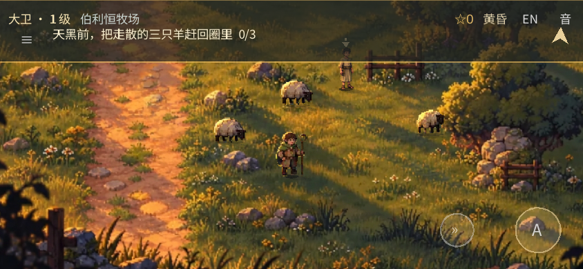
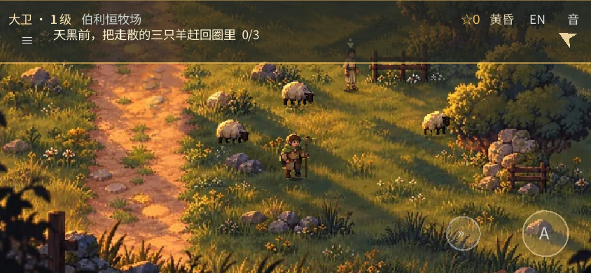
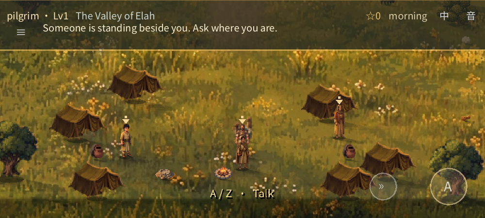
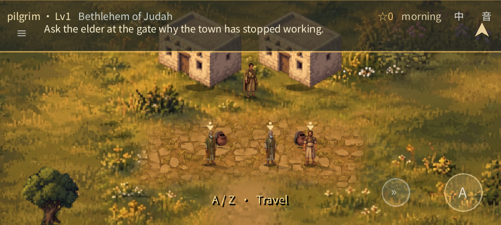
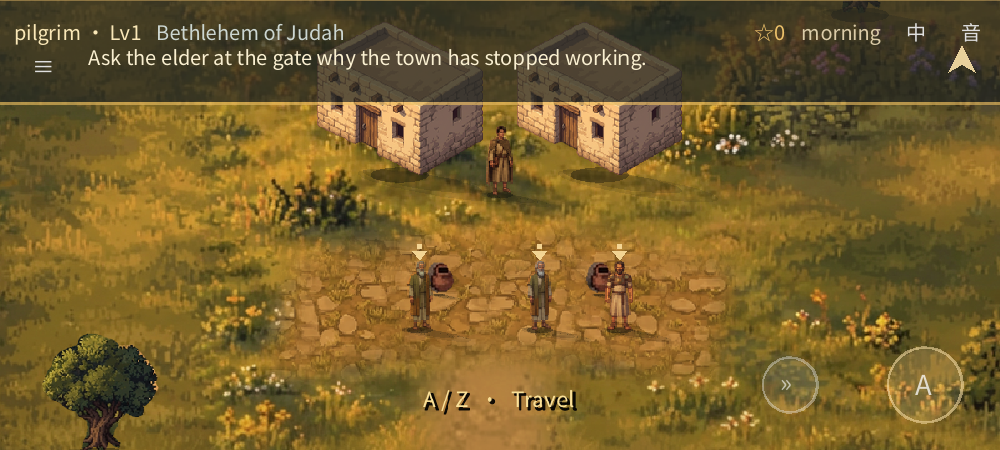

# Sunset-field detail: working-branch review

The published game is still the previously approved phone-playtest build. **This detail pass has not been published or approved as final art.** It responds to feedback that the game looked less detailed than the [attached 740×413 sunset-field image](../../tools/proto/sources/user_sunset_field.png).

## Shepherd field in the browser

These are real Chromium/SwiftShader captures of the staged shepherd act at the same **844×390 CSS-pixel** viewport. The animals and arrow can move between captures. They are not photographs of a phone.

| Published version | Working detail pass |
|:---|:---|
|  |  |

[Open the new staged field at DPR 2](quality-review/browser-field-dpr2.webp) — the test used an 844×390 CSS viewport and a 1688×780 canvas. This confirms that emulated browser's backing resolution, not the quality or performance of any particular phone.

The field now uses pixels registered from the supplied image over most of the old backdrop. The people and five sheep in that image are excluded so the actual moving actors are not doubled; their surroundings and the repainted right edge retain the existing inpaint. Tree, fence and foreground depth layers were rebuilt from the same composite.

The source is the image the user supplied, **not a newly discovered higher-resolution master**. About 85.7% of the backdrop receives reference pixels at greater than 94% opacity; the remainder includes feathered transitions and the old edited areas. The game camera, HUD and movable characters necessarily give a different crop from the still reference.

## Wider world: original source detail

The existing independent props were rebuilt from their original painted source images onto three-times-denser canvases, with their previous visible bounds and world-sized footprints retained. Tents, trees and houses show the clearest difference; source-limited reference sheep cannot gain invented detail. The map ground was **not** replaced or enlarged: a higher-density ground-only experiment produced only a modest improvement, and the tested generated alternatives were not suitable. Repeated instances such as tents still share sprites.

These 1000×450 native Godot/llvmpipe views use the same staged camera positions. The before frames swap in the prior prop textures; the after frames use the working assets. They are review fixtures, not a playthrough or a phone capture.

| Previous props | Rebuilt props |
|:---|:---|
|  |  |
|  |  |

[Fold: before](quality-review/fold-old.webp) · [Fold: after](quality-review/fold-new.webp) · [Bethlehem well: before](quality-review/well-old.webp) · [Bethlehem well: after](quality-review/well-new.webp)

## Depth and validation

The field's contours are still approximations. Staged captures show David [behind the fence](quality-review/field-fence-back.webp) and [in front of it](quality-review/field-fence-front.webp), [behind the tree](quality-review/field-tree-back.webp) and [in front of it](quality-review/field-tree-front.webp), and by the [foreground edge](quality-review/field-foreground.webp). Automated checks also compare opaque pixels in all three masks to the restored backdrop; they do not replace human visual review.

- A fresh automated browser journey reached the chapter ending: **33 checks**. Replay/recovery: **34 checks**. Browser layouts, bilingual controls and emulated touch: **36 checks**. The strict release export: **30/30**, without browser errors or warnings.
- Godot headless: shepherd stage **54/54**, resume **24/24**, painted world **70/70**, save slots **38/38**, context **35/35**, audio contract **21/21**, deep **144/144**, plus smoke and content checks. Native software OpenGL rendered **18 frames** without replacing the old baselines.
- Regeneration checks cover the restored field, exclusions and depth pixels, plus all **20** rebuilt props and their prior canvas bounds. Both existing ground images regenerated pixel-for-pixel unchanged. Web and Android-preset release PCK boundaries passed; the Android PCK is not an APK.

The wider world is still a separate interpretation rather than the original painting, its actors use limited/procedural animation, and the new masks are not full 3-D depth. No physical-phone performance/appearance test or listening test has been performed. Further publication needs separate approval; review this pass before deciding whether it is close enough.
