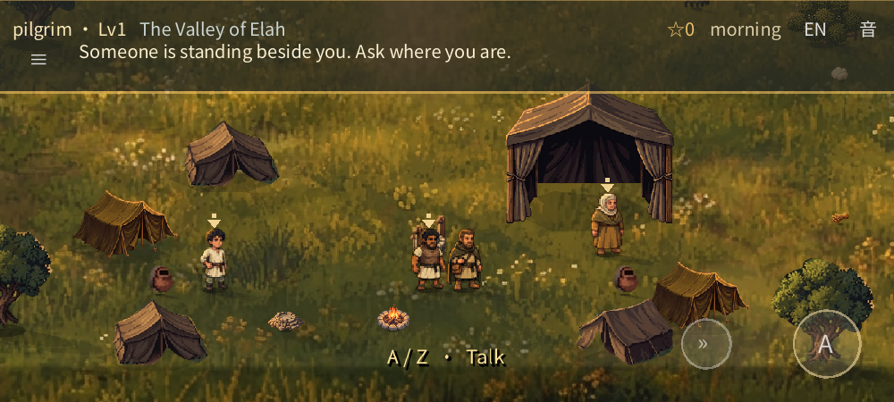
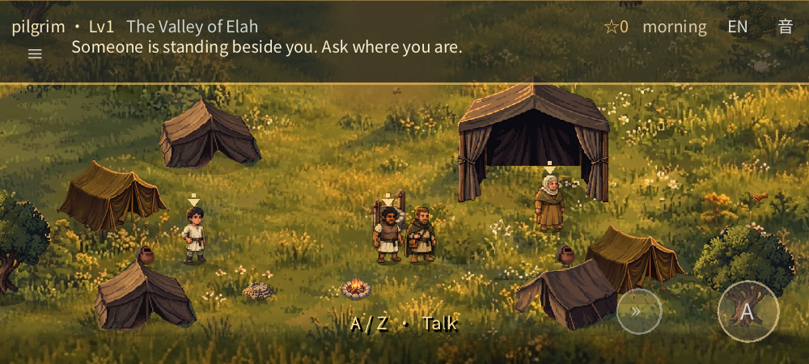
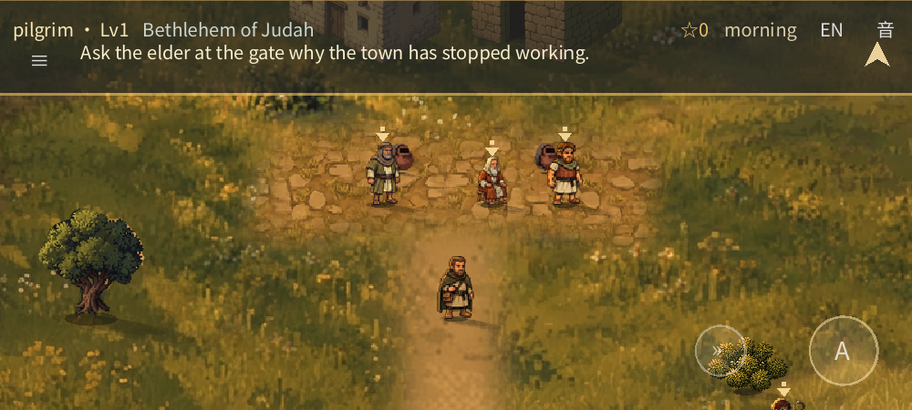
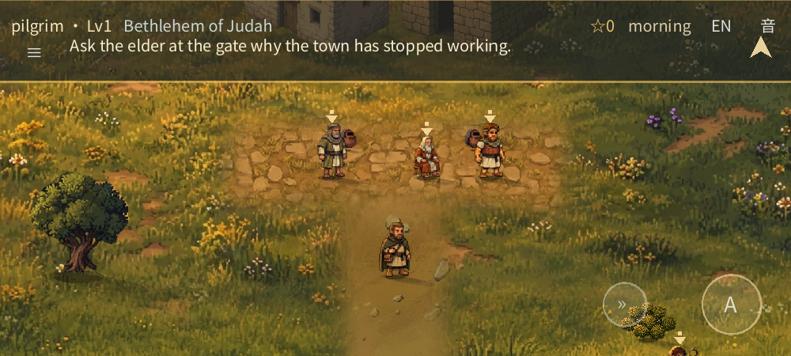
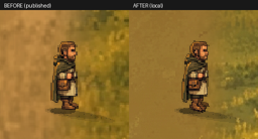
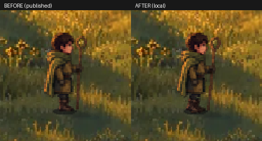

# Chapter movement, scale and ground refinement

This refinement was published with the user's approval from game revision `d8526c3`. Its [passing CI build](https://github.com/fongway94/WalkInCovenant/actions/runs/43251709210) supplied the exact Web artifact used by the [one-time publication](https://github.com/fongway94/WalkInCovenant/actions/runs/43316898488). The [public chapter playtest](https://fongway94.github.io/WalkInCovenant/) now also includes the later [ground-clarity](GROUND_CLARITY_REVIEW.md) and [painterly-ground](PAINTERLY_GROUND_REVIEW.md) passes. The comparison baseline below is the tree at `1de5452`, which has the same game content as the earlier published `e66ba37`.

## The world at the same camera positions

The following pairs are actual 1000×450 native Godot framebuffers from the same staged positions and lighting. The pass changes scenery scale as well as the ground; these are not isolated ground-only comparisons. WebP images are lossless.

| Before | After |
|:---|:---|
|  |  |
|  |  |

[Revised stream crossing](refinement-review/crossing-after.webp) · [Saul in the real browser journey](refinement-review/saul-journey.webp) · [Actual release-Web Elah camp at an emulated 844×390 viewport](refinement-review/phone-camp.webp)

Elah and Bethlehem now use sharper, map-aligned ground split into two pieces per region. The revised masks retain the original river, crossing and irregular shoreline; the ridge has a softened, uneven verge. New ground uses several non-repeating meadow bands rather than stamped flower clusters. The existing field painting, map coordinates and collision remain unchanged. The ordinary tents, houses, trees, well, jars and shrubs have been rebalanced visually, with a new mature fig tree. Saul's open-front tent keeps its separately calibrated scale and sorting. Some scenery and paving still repeat.

## Motion

The clips pair **rendered framebuffer crops** from a staged fixture that invokes the production movement code in fixed 1/24-second steps while the camera follows each actor. The backgrounds move because the actors actually travel. They are enlarged with nearest-neighbour sampling, not redrawn animation. Their embedded “published” and “local” labels describe the time of capture: the left is the earlier `e66ba37` game, and the right is the refinement published as `d8526c3`, before the later ground-only clarity pass.

| Witness, side walk | David, side walk in the field |
|:---|:---|
|  |  |

The shared gait eases in and out, adds a small weight shift and lean, and advances with travel distance. It uses layered cutouts and a subdued second profile foot, **not hand-authored walk cycles**. Samuel remains seated; long hems and capes keep most of their silhouette, and the armour overlay follows David's body. The visual fixture also captured both actors from all four directions, a run, three stops, two NPC patrols (the woman's is fixture-only), and armour from three sides.

## Verification and limits

- Fresh real-input Chromium journey from the witness through the ending passed, including a one-sheep save/reload, Saul and armour, brook and duel; a separate staged interruption checked sheep cleanup. No unexpected page or console errors.
- Strict release-Web validation: **30/30** checks; emulated responsive/touch layout: **36**; replay and unreadable-save recovery: **34**. Touch was emulated, not tested on a physical phone.
- An isolated local service-worker upgrade from the earlier export to the refined export loaded the new pack and preserved a real conversation, its earned word, the chapter act and a changed sound setting in IndexedDB. This was a simulation, not a live-site upgrade.
- Native gameplay suites passed: painted world **129/129**, shepherd stage **54/54**, resume **24/24**, context **35/35**, save slots **38/38**, audio contract **21/21**, deep **144**, plus smoke and content tests. Native software OpenGL rendered the 18-frame regression and the reference/prototype fixtures.
- Reproducibility checks passed for four split grounds, the new fig and **27** character views / **108** layers. The ground check also verifies unchanged water and protected shoreline pixels. The local Web and Android-preset release PCKs contained **856** indexed resources and excluded test fixtures; the separate disposable browser pack contained **963**. An Android PCK is not an APK.
- The new movement capture fixture passed with **12** real player walks/runs, **3** eased stops and **2** NPC patrols. A CI gate checks its completion and failure count; the captures themselves require visual review.
- The first hosted build of this pass, [run 43246174951](https://github.com/fongway94/WalkInCovenant/actions/runs/43246174951), passed its build and visual jobs but failed the browser journey at timed practice with no hits. A staged negative control reproduced 14 misses when 400 ms was added to the old driver's key delivery. The revised read-only driver waits for registered shots and adjusts its lead; real-input staged practice passed with 0, 100, 200, 300 and 400 ms added delay. This supports a timing-flake diagnosis but does not prove the exact cause on the hosted runner. [CI 43251709210](https://github.com/fongway94/WalkInCovenant/actions/runs/43251709210) subsequently passed the whole journey, layout, replay and 0/200/400-ms practice checks for the published game revision.
- The publication verified that the public PCK matched the tested artifact and the service worker had the new revision; a fresh public Chromium play-check passed **30/30** with no console, page or request errors. This is not a physical-phone or listening test.

The local Web PCK is about **30.03 MiB**, versus **20.27 MiB** for the earlier local export; the largest ground texture dimension is 2048 pixels. Mobile memory, download time and performance have not been measured on a physical device. Animation, generated angles and visual quality still need human judgment; there has been no listening test. Immediate engine shutdown can still report ObjectDB/resource warnings.
