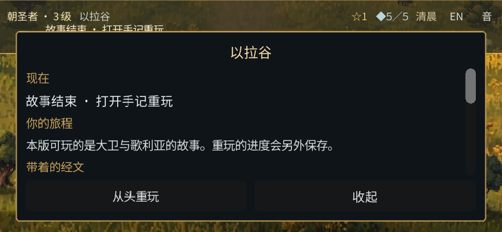
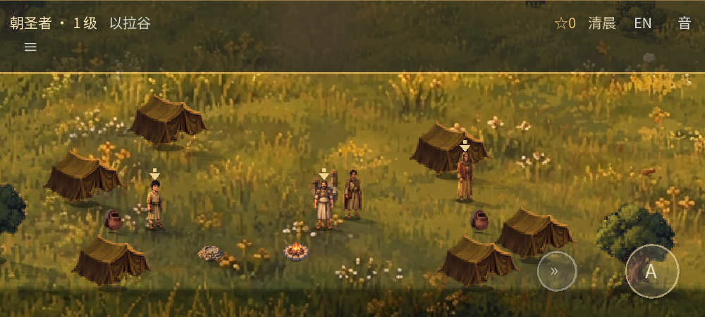

# David and Goliath: replay and world-art review

The approved shepherd-field prototype remains the visual reference. The wider-world art shown here is a **proposal for review**, not an approved replacement. Only the David and Goliath/Elah story is currently playable. These images document the published v7 playtest; the later, unpublished [detail pass has its own before/after review](QUALITY_REVIEW.md).

## Replay without resetting the original

1. Open the book with **☰**. Choose **从头重玩 / Start replay**, read the explanation and confirm.
2. The replay starts at the beginning in its own save. Open the book again and choose **返回原旅程 / Original journey** to return to the original. Each journey retains its own progress and sound settings.
3. If the original save cannot be read, saving pauses and the book shows a warning. Do not clear the browser's site data: that could remove the files. These are local saves in the same browser, not a cloud backup.

[Completed original](world-review/replay-completed-phone.webp) · [Fresh replay](world-review/replay-fresh-phone.webp) · [Unreadable-save warning](world-review/replay-save-warning-phone.webp)

## Proposed wider world

- [Elah camp / starting area](world-review/camp-phone.webp)
- [Sheep fold and hired boy](world-review/fold-phone.webp)
- [Brook and crossing](world-review/brook-phone.webp)
- [Bethlehem paving and houses](world-review/bethlehem-phone.webp)
- [Bethlehem well](world-review/well-phone.webp)
- [Elah ridge and champion](world-review/ridge-phone.webp)

These are actual Chromium/SwiftShader renders at a phone-shaped viewport. The camera and story states were **staged for review**; they are not screenshots of a person playing on a phone. The grass now uses different large painted sections rather than repeatedly stamping the conspicuous flower bed, while the paving uses smaller mixed crops. Some individual props, such as tents, still share a sprite. The source materials and builders are in `tools/art/`; art and collision remain separate.

Please look especially at whether the Bethlehem well's grass scale and the different ground treatments feel consistent with the approved field, and whether the tents, sheep and camp objects fit the same world. These images are evidence to discuss, not an assertion of art approval.

## What has and hasn't been checked

The v7 build passed a fresh automated browser journey from the opening to the ending, replay/recovery and bilingual-control checks, browser layout and release checks, headless regressions, and a native software-rendered frame suite. The full-story path used real keyboard input; the replay and layout checks include emulated touch. See `docs/AGENT_CONTINUATION.md` for scope and counts.

The new build has **not** been reviewed on a physical phone or Android device, and its audio has not been reviewed by ear. The user approved publishing this proposal for a phone playtest at https://fongway94.github.io/WalkInCovenant/; that is not approval of the wider-world art. Any further deployment needs separate approval.
