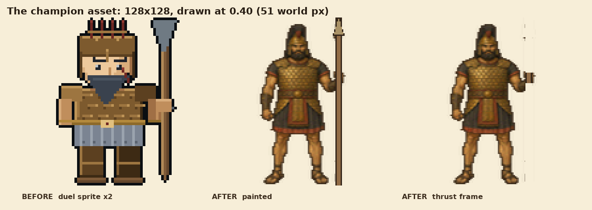
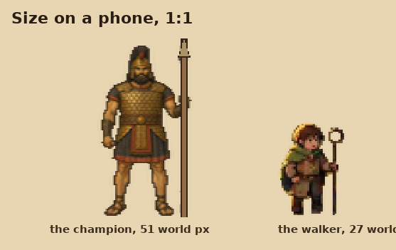
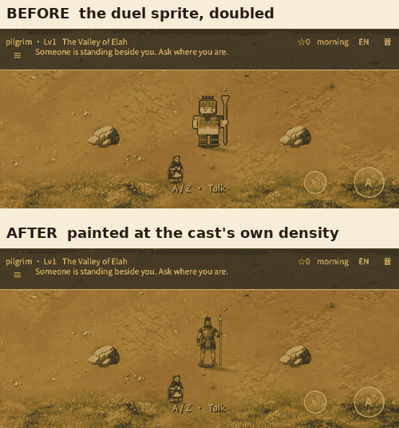

# The champion was the old game's art

The user's phone screenshot of the Valley of Elah showed a blocky bronze soldier
standing in the painted meadow and asked the obvious question: *this soldier art
is the old one — check through everything.*

They were right, and it was a regression I had introduced.

## What was actually wrong

`art/scenes_painted/goliath.png` — the ridge champion **and** the champion in the
duel — was the 64×64 duel sprite doubled with nearest sampling. The folder says
"painted"; the contents were the previous game's pixel art.

| commit | what `art/scenes_painted/goliath.png` held |
|---|---|
| `58554b2` | a painted 128×128 bronze warrior (16,641 bytes) — rejected as "a statue", not the cast |
| `1314c7e` | **the old duel sprite (1,657 bytes)**, and its source deleted |
| this branch | a painted 128×128 champion at the cast's density (12,202 bytes) |

`1314c7e` is my own trees pass. I replaced an art mismatch with a bigger one: at
twice a person's height, a doubled 64×64 sprite reads as blocks twice the size of
everybody else's pixels. A routine rebuild of `build_painted_setpieces.py` is what
kept it there.

## What it is now

`tools/art/build_champion.py` builds both frames from one painted source
(`tools/art/sources/champion_goliath.png`):

- keyed off its flat ground and median-filtered, so the silhouette is clean at one
  pixel;
- fitted to a **128-tall canvas at twice the 27.4-pixel walker** — the geometry
  the ridge, the duel's aim bands, `painted_world.gd` and `scale 0.40 / offset
  (0, -64)` are all tuned against;
- reduced to **32 levels a channel**, which is what turns a smooth rendering into
  gouache at this size, and **widened 1.3×** so a giant reads as a big man rather
  than a tall thin one;
- the outermost opaque ring is darkened toward the **ink line** every cast figure
  carries;
- the **spear is redrawn** (5 px shaft, bronze head, ink edges). The painted shaft
  is 1.3 pixels wide once fitted — invisible in the valley. The thrust frame
  erases that shaft and its head *exactly*, above and below the fist, because a
  six-pixel band clipped the fingers that wrap it.

## In the game

Same camera, same probe, same speech. The "before" frame is run `43548673264` —
the build that is live now; the "after" frame is run `43564367816`.

## What "check through everything" found

- **Fixed:** the ridge champion and the duel champion (one asset, two places).
- **Solid:** every placed prop in the painted regions resolves to
  `art/props_painted/` (checked the six props with no painted version — boat,
  cistern, column, gate, millstone, palm_tree — and only `gate` appeared in region
  data, as an objective key, not a sprite). Every named actor in the painted
  theme resolves to a painted rig in `art/characters_reference/`; the rank-and-file
  `soldier` actor already maps to `corin`'s painted rig.
- **Still old art, not fixed here:** the eight dialogue portraits in
  `art/facesets/` are 32×32 pixel faces in the previous game's idiom, including
  `goliath.png`. They are palette-locked and verified by `tools/check_faces.py`,
  so repainting them is its own pass, not a spare-moment edit. They are the next
  thing a player will notice if the champion now looks right and the portrait
  does not.
- **Deliberately unchanged:** the classic theme's own art, the duel's cut
  geometry, collision, saves, the brook, the trees and the shoreline ring.

## Gates

- `tools/art/build_champion.py --check` — verified (2 files).
- `tests/proto/check_quality_assets.py` — every sheet PASS.
- `tools/art/build_refined_ground.py --check` — verified.
- `tests/painted_world.gd` — 130 checks, 0 failures. The thrust check no longer
  pins `106/20/104`: it finds the shaft (the one column solid from the top row
  through his shoulder) and the grip (the first row solid in both frames), so it
  measures the hand that must survive whatever the art does next.
- `gd_lint`, `xref_check`, `check_faces`, `check_cinematic_art` — clean.
- CI run `43564367816` on `e594455`: every job success, deploy skipped.

**Not published.** The live build is still `7781975461`; this pass needs a fresh
approval like every other one.
