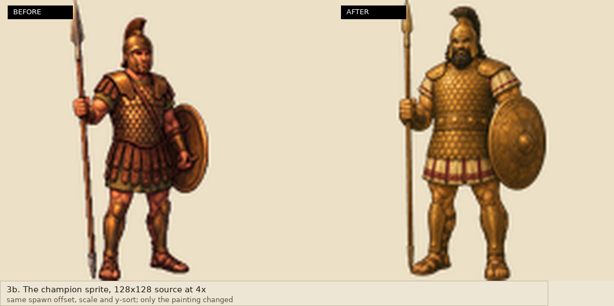

# River, tree height and the northern figure

Three requested changes are implemented on branch `arena/0854f8bd-walkincovenant`
and verified by hosted CI. Nothing is deployed: the branch build produces the Web
pack, but the `deploy` job only runs for `main`, and publication still needs the
user's separate approval.

| # | Request | What changed | Where |
|---|---------|--------------|-------|
| 1 | River detail at the ground's painterly level, shoreline and crossing included | Water surface rebuilt with square-sampled fine grain, stretched current bands, short broken dashes, four-note colour dabs and wet shading against stones and banks | `tools/art/river_detail.py`, `art/scenes_painted/world_elah_refined_bottom.png` |
| 2 | Trees visibly **taller** than people, not wider | Tall olive/fig canvases scaled to 82 / 78 world pixels against a 27.4-pixel person (about 3x), feet and trunk anchors unchanged | `art/props_painted/olive_tree_tall.png`, `fig_tree_tall.png`, `scripts/world/Region.gd` |
| 3 | The mismatched figure seen walking north | The ridge Goliath repainted in the painterly bronze style used by the duel | `art/scenes_painted/goliath.png`, `goliath_striking.png` |

## Evidence

The four in-game frames are real framebuffers from `tests/art_review_probe.tscn`,
captured under Xvfb with software OpenGL in CI run
[43458686659](https://github.com/fongway94/WalkInCovenant/actions/runs/43458686659)
(commit `a968c5b`). They arrive here through the run's annotations, so they are
500x225 at 24 colours derived from the 1000x450 capture; the art-scale panels
(1b, 3b) are native pixels.

## What is and is not touched

- Water: only pixels of the painted-water mask are repainted. The audit in
  `tests/proto/check_quality_assets.py` still proves the bank, reeds, the ford's
  pale approach and every sunlit stone are byte-identical, that five stone
  coordinates stay unpainted and four water samples stay painted, and that the
  repaint stays inside the brook band. Collision, crossing tiles, shore geometry
  and saves are untouched.
- Trees: same footprints, anchors, shadow and y-sorting; only the canvas and the
  visual scale changed. `tests/painted_world.gd` measures the visible sprite
  height at runtime (olive 82, fig 78, person 27.4) and `check_tall_trees()`
  checks the canvases are foot-anchored, upright, transparent-matted and
  byte-reproducible.
- Champion: same 128x128 source size, bbox, spawn offset, scale, y-sort and
  per-theme texture filter. The strike variant's spear cut is now a narrow band
  around the shaft, so it no longer clips his left shin.

## Verification

Hosted [run 43458686659](https://github.com/fongway94/WalkInCovenant/actions/runs/43458686659)
passed lint (static, xref, API, font, pack, painted-world and the chapter
contracts), the visual job with the four new review frames, both art-review
publication jobs, export-web, the release browser suite, the chapter browser suite
and the proto browser suites. `deploy` was skipped, so
https://fongway94.github.io/WalkInCovenant/ still serves the previously approved
build.

Locally: `gd_lint` clean (57 files), `xref_check` clean, `check_font` 850
codepoints, `check_faces`, `check_art_reset`, `check_craft_props`,
`check_cinematic_art`, `tests/proto/check_quality_assets.py` (refined fig, tall
trees, meadow, paving and painterly water with protected bank),
`tools/pack_art.py`, `test_pack_contents` (9 tests), `test_api_reference`
(5 tests) and `node --test tests/browser/seeded_boot.test.cjs` all pass.

Not verified: appearance on a physical phone, and human art approval. Automated
checks establish geometry, protection of shoreline pixels and reproducibility,
not taste.
