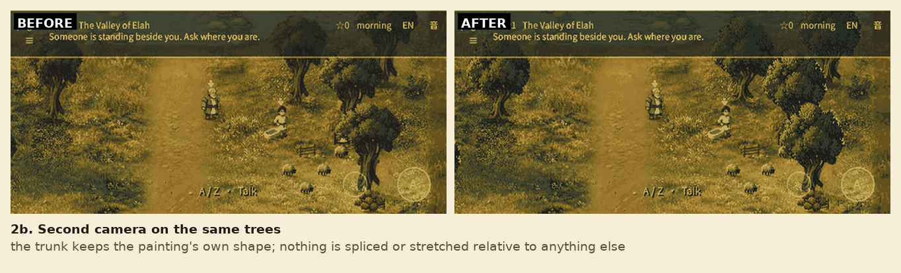
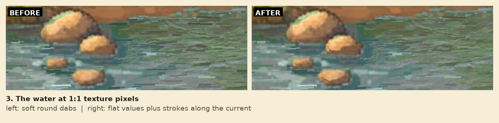
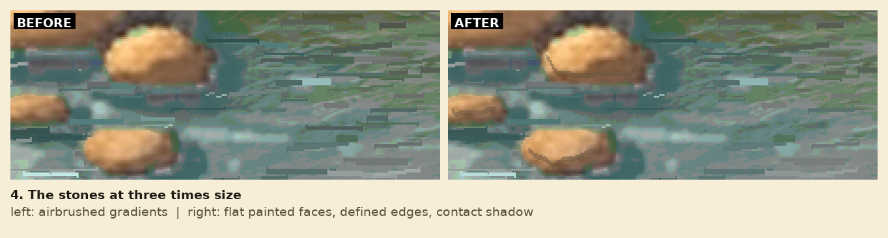
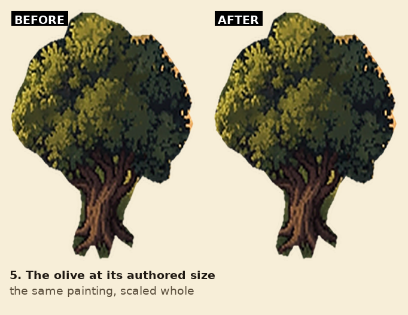
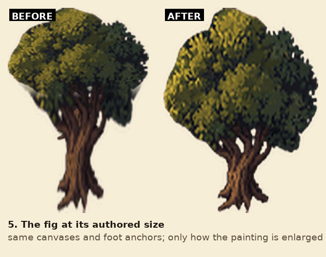
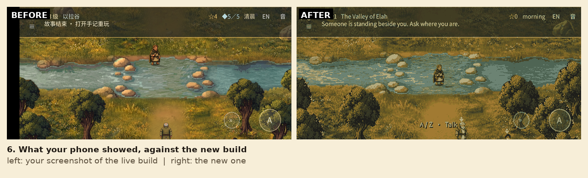

# River and trees, third pass

The phone screenshots after the second pass said three things: the water was
still blurred, the trees were closer but still not right in detail, and the
trunk had "residual of old object" and roots "showing out all".

## What was actually wrong

**The trees.** The second pass grew the taller trees by stretching the source
painting's trunk. That gained height, but it magnified the painted root flare
into long splayed legs and dragged the canopy's lower lobes down beside the
trunk — the "residual of old object" the user could still see. Both trees are
now the overworld's own paintings *scaled whole*: one height factor to the
authored canvas, one horizontal bias (1.30) to keep the tree upright, then an
unsharp pass. Nothing is spliced or stretched relative to anything else, so the
trunk and roots keep the proportions the painting gave them.

**The stones.** They were the last airbrushed thing in the river: soft
gradients with no edge of their own. Each stone's interior is now unsharp-masked
and flattened onto a handful of values, with a one-pixel lit top and a darker
underside, while the three-pixel ring that beds it in the water keeps the
shoreline's exact pixels.

**The water.** The brook was airbrushed soft because its detail was smaller
than a screen pixel: 1-pixel grain in a texture drawn at roughly 1 texture
pixel per screen pixel averages away. The surface is now posterised to three
bits per channel and repainted with brush-sized strokes — 10–40 px long, 2–4 px
thick, hard edges — alternating dark undertow and light crest along the current,
with broken foam on the upstream rim of every stone. The strokes are the size
of the meadow's own grass tufts, which is why the grass beside it reads crisp.

## What is and is not touched

- Trees: same canvas heights (276 / 272), same foot anchors, same runtime
  scales, so the world still measures 82 and 78 pixels against a 27.4-pixel
  person. Widths changed (204 / 205 against 207 / 187) because a whole-painting
  scale keeps the source's aspect; collisions, props, y-sort and shadows are
  untouched.
- Water and stones: only painted water and the stones' interiors change. The
  audit proves the bank, reeds, ford approach, the ring around every stone and
  the five surveyed stone coordinates are untouched by the water pass, that the
  stone pass never overlaps water, that the stones stay warm-coloured rather
  than turning to water, that four water samples stay painted, and that nothing
  escapes the brook band. Collision, crossing tiles, shore geometry,
  story and saves are untouched.
- The champion is unchanged from the second pass: the duel's own pixel sprite at
  2x with nearest sampling.

## Verification

[Run 43548673264](https://github.com/fongway94/WalkInCovenant/actions/runs/43548673264)
(commit `54a6017`) passed every job: lint, the shepherd-field prototype frames,
the visual review frames, both art-review publications, export-web, the release,
chapter and proto browser suites. `deploy` was skipped for this branch push.

The frames above are real framebuffers from `tests/art_review_probe.tscn`,
captured under Xvfb with software OpenGL in that run; the "before" frames are the
same probe in run 43542069284 (commit `b796f65`), the previous pass of this same
work.

Locally: `gd_lint` (57 files), `xref_check`, `check_font` (850 codepoints),
`check_faces`, `check_art_reset`, `check_craft_props`, `check_cinematic_art`,
`pack_art` (49 tiles, 26 props), `tests/proto/check_quality_assets.py` and
`test_pack_contents` (9 tests). `build_refined_ground.py --check` reproduces all
four ground textures byte-for-byte, and the water pass runs on Pillow alone — the
first attempt imported numpy, which CI does not install.

## Publication

Live: https://fongway94.github.io/WalkInCovenant/ serving deployment
`7781975461` (commit `54a6017`, run 43548673264), verified byte-identical to its
artifact: live `index.pck`
`15eb3b70d1b46e8210b42b7930cdf7611149d1517c88a7a2e87f33969be6bbcf`
(36,500,668 bytes), and `index.html` / `index.wasm` match too.

## The ceiling this pass runs into

The game's design canvas is **320x180 logical pixels** (`project.godot`,
`ScreenFit.BASE`) and it is stretched to the phone — about 4.9x on a
1568-pixel-wide screen. The ground texture holds four pixels per world pixel, so
at that window the texture is *downsampled* into the canvas and then upscaled
again. Detail finer than about one world pixel (four texture pixels) cannot
survive that round trip: it averages away, and the browser's filter turns what is
left into blur.

That is why the water kept reading as soft however much grain was added, and why
the stones read as airbrushed. Anything painted at 1-2 texture pixels is below
the visible threshold. Two ways forward:

1. paint the brook and the stones at 4-8 texture pixels (one to two world
   pixels), the scale the meadow's grass tufts already use, so the detail
   survives the downscale; or
2. raise the render resolution (for example a 640x360 canvas with the camera and
   UI scaled to match), which sharpens everything, not just the river, but is a
   layout change rather than an art change.

Neither is in this build.
