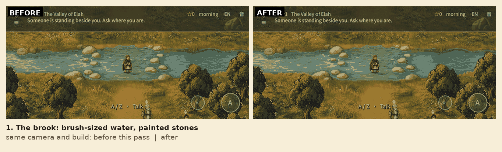
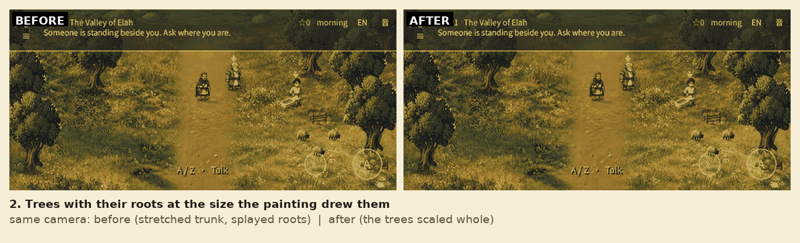
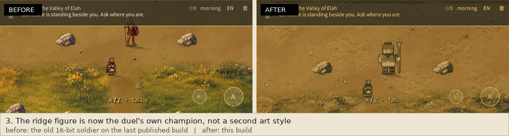
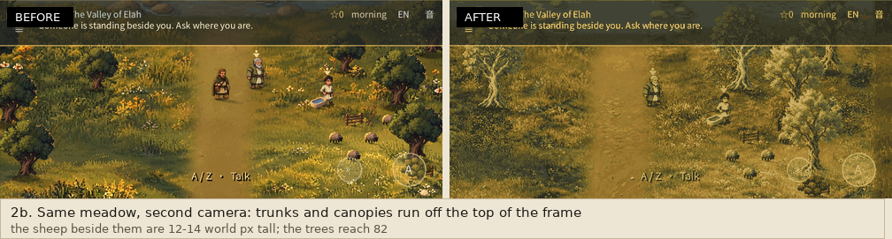
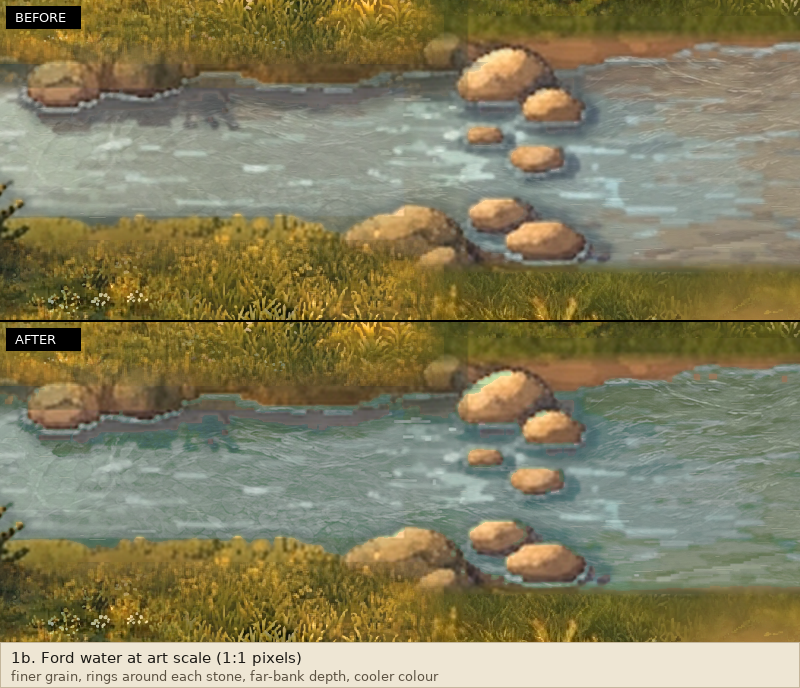
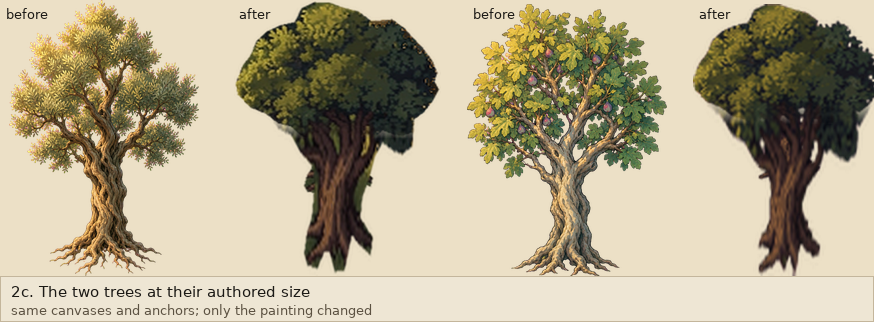
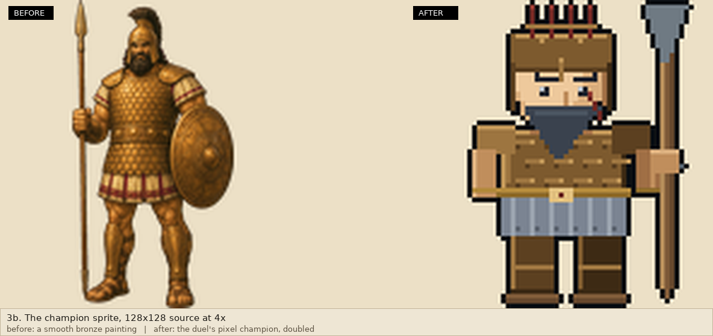

# River, tree height and the ridge champion

Three fixes, now in the second pass after the phone screenshots: the trees and
the champion were in a finer, smoother art language than everything around them,
and the water still read as wet stone.

| # | Request | What changed |
|---|---------|--------------|
| 1 | Water: "still low resolution and quality" | Fine and mid grain, three fading rings of disturbed water around every stone, a far-bank depth gradient, and the stream's own cooler, more saturated colour. The bright ford still stays calm and pale. |
| 2 | Trees: "look out of place" | Grown from the overworld's *own* accepted tree paintings: same rounded masses, thick trunk, warm palette, soft edge. The trunk is lengthened and nothing else is invented, so a tree stands three people tall in the world's brush. |
| 3 | Champion: "odd and different from our current character pattern" | The ridge figure is the duel's own pixel champion at 2x with nearest sampling: same pose, palette and inked edges as the cast, instead of a smooth bronze painting. |

## Evidence

The in-game frames are real framebuffers from `tests/art_review_probe.tscn`,
captured under Xvfb with software OpenGL in CI run
[43531764355](https://github.com/fongway94/WalkInCovenant/actions/runs/43531764355)
(commit `0a83b00`). They arrive through the run's annotations, so they are
500x225 at 24 colours derived from the 1000x450 capture; the art-scale panels are
native pixels.

## What is and is not touched

- Water: only painted-water pixels change. The audit still proves the bank,
  reeds, ford approach and every sunlit stone are byte-identical, that five stone
  coordinates stay unpainted and four water samples stay painted, and that the
  repaint stays inside the brook band. Collision, crossing tiles, shore geometry
  and saves are untouched.
- Trees: same canvases (276/272 tall), anchors, footprints, shadows and y-sort,
  so the runtime still measures 82 and 78 world pixels against a 27.4-pixel
  person. Only the painting inside the canvas changed.
- Champion: same 128x128 source, bbox anchor, spawn offset, scale and y-sort.
  The painted theme now uses nearest sampling like the cast, and the strike
  variant removes only the thin band of baked shaft so the duel's own thrust
  spear is not doubled.

## Verification

[Run 43531764355](https://github.com/fongway94/WalkInCovenant/actions/runs/43531764355)
passed lint (static, xref, API, font, pack, painted-world and the chapter
contracts), the visual job with the four review frames, both art-review
publication jobs, export-web, the release browser suite, the chapter browser
suite and the proto browser suites. `deploy` was skipped for this branch push.

Locally: `gd_lint` clean (57 files), `xref_check` clean, `check_font` 850
codepoints, `check_faces`, `check_art_reset`, `check_craft_props`,
`check_cinematic_art`, `tests/proto/check_quality_assets.py` (meadow, paving,
painterly water with protected bank, tall trees, actor views, variants),
`tools/pack_art.py`, `test_pack_contents` (9 tests).

## Publication

This pass is live at https://fongway94.github.io/WalkInCovenant/ (Pages
deployment `7779989318`, 2026-11-14 00:42 UTC) after the user's approval. Live
`index.pck` is `c2d89e4c14f8e7ba3582f9a0be9d7bdedb045a14af77917b8590612b2ee7b254`
(36,485,740 bytes) and is byte-identical to the reviewed artifact, as are
`index.html` and `index.wasm`; the comparison ran in CI because the authoring
sandbox cannot reach the site. The previous build (`87d8708`) was the
intermediate preview published earlier the same evening.

Not verified: appearance on a physical phone beyond the user's screenshots, and
human art approval.
